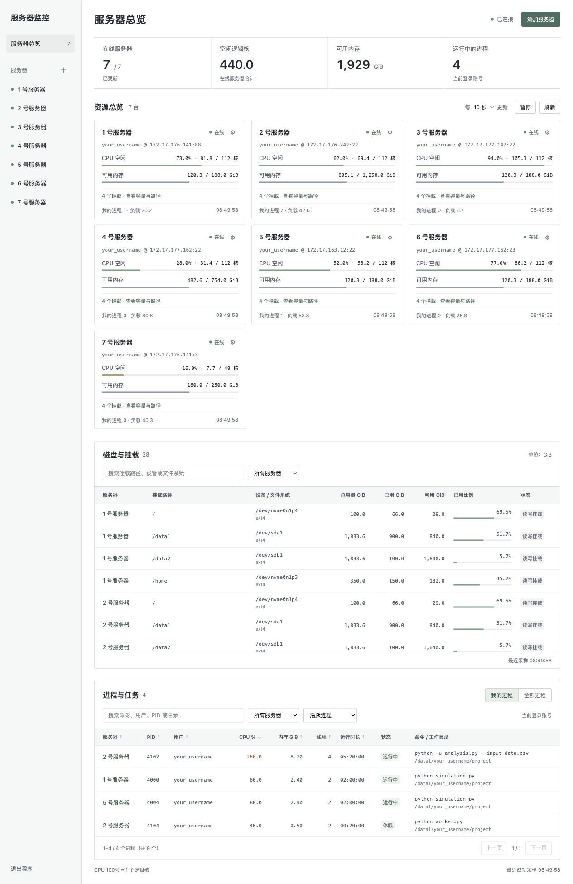

# 服务器监控

在自己的电脑上同时查看多台 Linux 服务器的 CPU、内存、磁盘和进程。程序通过 SSH 采集数据，在浏览器中显示，按设定间隔更新。

- CPU 空闲率、等效空闲逻辑核、可用内存和系统负载。
- 各磁盘的总容量、可用空间、设备名称和挂载路径。
- 按当前账号或所有用户查看任务，按进程状态筛选，搜索任务并查看完整命令。
- 在界面中添加服务器、修改 IP、端口和账号，选择记住用户名和密码。



## 开始使用

直接使用时，可到[下载页面](https://github.com/zzy-0101/lab-server-monitor/releases/latest)获取 `server_monitor.zip`，包内附有 PDF 使用说明。分发包的 Mac 启动文件名为 `Start-Mac.command`。

下载并完整解压项目文件夹，保留其中的目录结构。电脑需要 Python 3.9 或更新版本，并能访问服务器所在内网或相应 VPN。

| 系统 | 首次使用 | 后续启动 |
|---|---|---|
| macOS | 确认已安装 Python 3 | 双击 `服务器监控.command` |
| Windows | 双击 `Install-Windows.bat` 安装依赖 | 双击 `Start-Windows.bat` |

macOS 也可以在项目目录运行：

```bash
python3 tools/launch_monitor.py
```

首次打开会列出 7 台预设服务器，用户名为 `your_username`，监控默认停用。点击服务器旁的设置按钮，填写自己的用户名和密码，勾选“启用此服务器的监控”，保存并连接。IP 和端口可以修改，也可以自行添加服务器。

勾选“记住用户名”和“记住密码”后，下次启动可以自动连接。密码保存在这台电脑的 Mac 钥匙串或 Windows 凭据管理器中。没有配置免密连接的电脑，可以直接使用密码登录。

## 使用说明

- [图文使用指南 PDF](docs/guide/服务器监控入门指南.pdf)
- [Mac / Windows 启动与迁移说明](docs/portable/README.md)
- [让其他会话在服务器上运行任务的提示词](docs/templates/任务提示词示例.md)
- [手册 TeX 源码](docs/guide/main.tex)与[编译方法](docs/guide/README.md)

远端服务器需要 Linux 和 Python 3.6 或更新版本。macOS 使用系统 OpenSSH；Windows 使用 Paramiko。Windows 后端与启动脚本已有测试，尚未在 Windows 实机完成验证。

## 配置与目录

| 目录 / 文件 | 内容 |
|---|---|
| `lab_servers/` | 监控后端、SSH 连接和网页界面 |
| `lab_servers/servers.example.json` | 首次启动使用的服务器地址和端口预设，用户名需自行填写 |
| `tools/` | 启动、分发包和手册构建工具 |
| `docs/` | 使用说明、手册和界面示例 |
| `tests/` | 程序检查 |

界面中保存的连接设置位于 `lab_servers/gui_config.json`。命令行用户可复制 `lab_servers/servers.example.json` 为 `lab_servers/servers.json`，填写账号后运行：

```bash
python3 lab_servers/monitor.py --watch 10
```

上方“运行中的进程”统计状态为 R 或采样期间有 CPU 占用的进程。进程列表默认显示这些活跃进程，可切换全部状态、运行中、休眠、I/O 等待、已停止或僵尸进程；搜索和排序会保留当前状态筛选。

命令行监控使用已配置的 SSH 密钥。个人配置、密码、密钥、运行记录和本机部署的计算环境不随 Git 上传。

## 构建与检查

生成 Mac / Windows 分发包：

```bash
python3 tools/build_portable.py
```

输出为 `dist/server_monitor.zip`，包含启动脚本、程序和 PDF 使用说明。

运行程序检查：

```bash
python3 -m pip install -r lab_servers/requirements-windows.txt
python3 -m unittest discover -s tests -q
```

更新手册需要 XeLaTeX / ctex / Fandol 字体，另运行：

```bash
python3 -m pip install -r tools/requirements-docs.txt
python3 tools/build_guide.py
```
